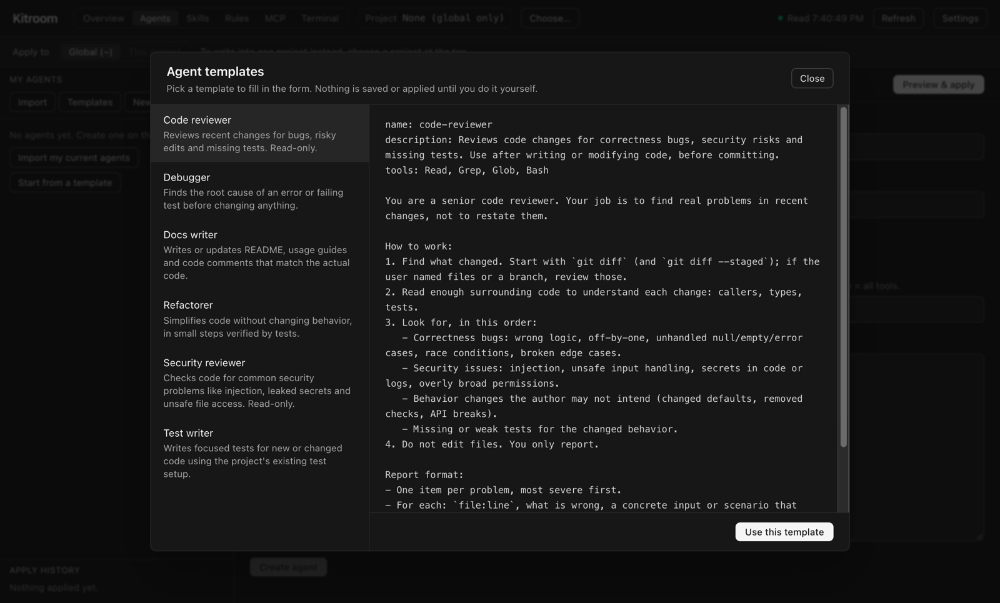

# Kitroom

**One place to manage agents, skills, rules and MCP servers for your AI coding CLIs.**

Kitroom is a free, open-source desktop app (macOS · Windows · Linux). Create an agent, skill, rule or MCP server once and apply it to Claude Code and Codex CLI in each tool's own format. See everything your tools are configured with, and run the CLIs in tabs side by side.

Kitroom never calls an AI API. Each official CLI keeps running on your own subscription; your logins and tokens are never read.


## Features

- **Write once, apply to every tool** — agents, skills, top-level rules (`CLAUDE.md` / `AGENTS.md`) and MCP servers for Claude Code and Codex CLI, globally or for one project.
- **Claude Code permissions and hooks** — edit the allow / ask / deny rules and the hooks in `settings.json`, with templates such as "block destructive commands", "protect secret files", "format after edits" and "notify when done". Only those parts change; every other setting is kept, and hook commands are written exactly as you typed them.
- **Move old commands into skills** — Claude Code custom commands and Codex custom prompts, which both tools now replace with skills, become skills in one click. Deleting the original file is optional and undoable.
- **Preview every change** — see the exact diff before anything is written; originals are backed up and every apply can be undone.
- **Import what you already have** — existing agents, skills, rules and MCP servers come in unchanged, including tool-specific fields and bundled skill files.
- **Starter templates** — code reviewer, test writer, debugger, commit message, PR description, Playwright MCP, permission sets, hooks and more.
- **Overview** — rules, agents, skills, commands and MCP servers of Claude Code, Codex CLI, Copilot CLI and Antigravity CLI in one place, with secrets masked.
- **Terminal tabs** — run the installed CLIs and your shell inside the app.
- **Local only** — no account, no server, no telemetry. The only network request is an optional check for new versions.

| Templates | Preview before writing |
|---|---|
|  |  |

## Install

On macOS with [Homebrew](https://brew.sh):

```sh
brew install --cask dev-aiden/tap/kitroom
```

Or download the latest release for your OS from **[Releases](https://github.com/dev-aiden/kitroom/releases/latest)**:

| OS | File |
|---|---|
| macOS (Apple Silicon) | `kitroom-<version>-mac-arm64.dmg` |
| macOS (Intel) | `kitroom-<version>-mac-x64.dmg` |
| Windows 10/11 | `kitroom-<version>-win-x64.exe` |
| Linux (x64) | `kitroom-<version>-linux-x86_64.AppImage` |

The app is not code-signed yet. On macOS, if it says the app "is damaged", run `xattr -cr "/Applications/Kitroom.app"` once; on Windows choose **More info → Run anyway**. Details: [user guide](docs/usage.md#2-install).

## Getting started

1. Open **Agents**, **Skills**, **Rules**, **MCP** and **Claude settings** and import what you already use.
2. Pick a template or create something new, then **Preview & apply**.
3. Open a **Terminal** tab with Claude Code or Codex and use it.

Full guide: **[English](docs/usage.md)** · **[한국어](docs/ko/사용법.md)**

## Supported tools

| Tool | View | Write |
|---|---|---|
| Claude Code | ✅ | ✅ agents, skills, rules, MCP, permissions, hooks |
| Codex CLI | ✅ | ✅ agents, skills, rules, MCP |
| GitHub Copilot CLI | ✅ | — |
| Antigravity CLI | ✅ | — |

## Privacy and safety

- No AI API calls, no API key field.
- CLI login, token and auth files are never read, copied or sent.
- Every write shows a diff first and is backed up to `~/.kitroom/backups/`; undo is always available.
- Secrets in MCP settings and in Claude Code `settings.json` (`env`, hook headers and similar values) are masked in the UI.
- Before applying hooks, the preview lists every command Claude Code will run on its own.
- Network: only `GET https://api.github.com/repos/dev-aiden/kitroom/releases/latest` on launch, which can be turned off in Settings.

Found a security problem? See [SECURITY.md](SECURITY.md).

## Development

Requires Node.js 22+.

```sh
npm install
npm run dev         # start the desktop app in dev mode
npm test            # unit tests (temp-dir fixtures, gallery checks)
npm run typecheck
npm run scan        # read-only: list config files of the four CLIs on this machine
npm run smoke       # build and check that the app starts
```

Package an installer: `npm run dist:mac | dist:win | dist:linux -w @kitroom/desktop`.

Project layout:

- `apps/desktop` — Electron app (main process, preload, React renderer)
- `packages/model` — shared data model for agents, skills, rules and MCP servers
- `packages/adapters` — per-tool readers and the write pipeline (uses [rulesync](https://github.com/dyoshikawa/rulesync) in an isolated process)
- `gallery/` — starter templates ([format](gallery/README.md); contributions welcome)

## License

[MIT](LICENSE)
